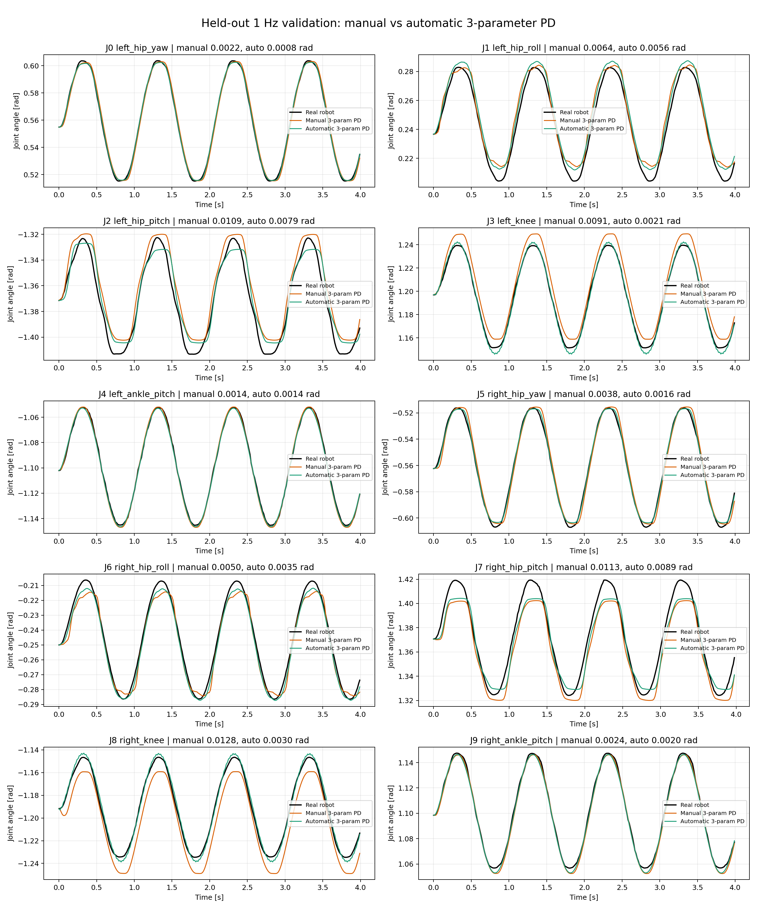
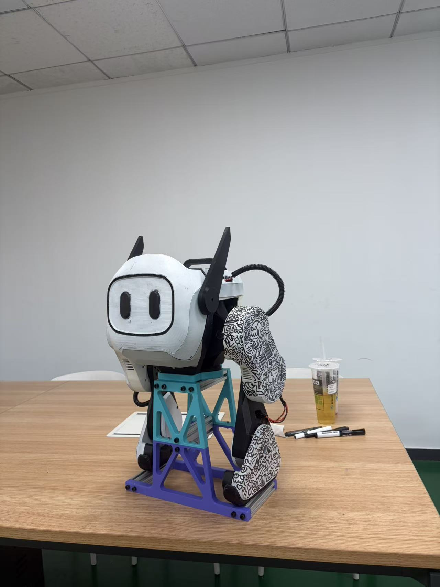
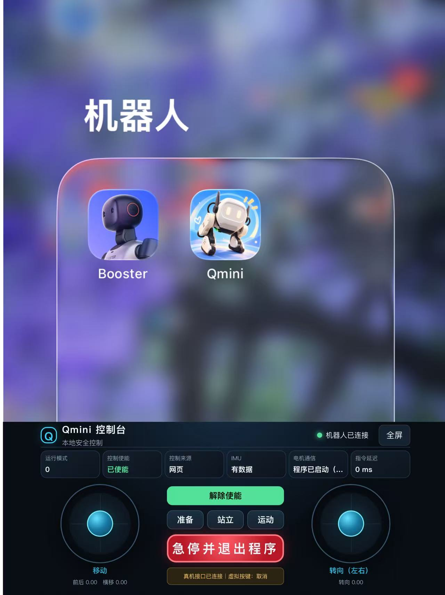
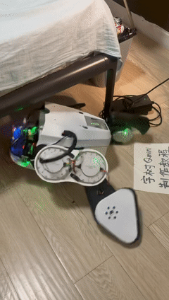
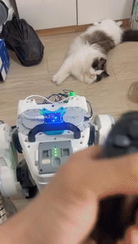
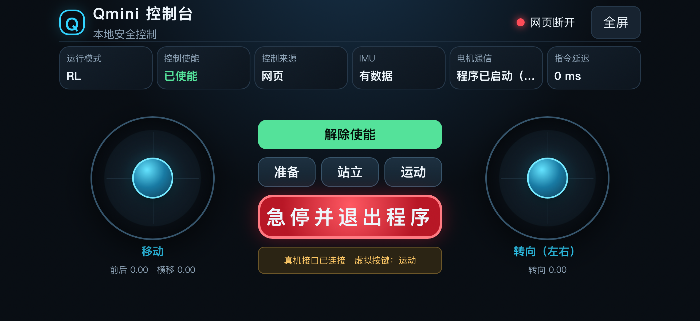

# Qmini 自动系统辨识与强化学习运动控制

> 面向 Qmini 双足机器人的自动 PD 参数辨识、Isaac Gym/PPO 训练、ONNX 真机部署与手机网页控制系统


## 项目简介

本项目基于 [vsislab/RoboTamer4Qmini](https://github.com/vsislab/RoboTamer4Qmini) 开展，目标不是只在仿真中训练一个能走路的策略，而是建立一条可验证的完整 Sim2Real 流程：

1. 在真机上采集 10 个关节的目标角、实际角度和速度响应；
2. 在 Isaac Gym GPU PhysX 中并行搜索等效 `Kp`、`Kd` 和控制延迟；
3. 对齐 URDF、关节顺序、正负方向、限位、参考站姿和 IMU 坐标系；
4. 使用 PPO 从零训练运动策略，并进行确定性回放与随机化测试；
5. 导出 ONNX，在树莓派 C++ ONNX Runtime 上完成静态验证和真机部署；
6. 使用 PS4 手柄或手机横屏网页控制机器人，并通过安全状态机处理准备、站立、运动和急停。

论文工作的重点创新是：**用自动系统辨识替代依赖经验的人工 PD 调参，在减少人工时间的同时提高真机响应拟合精度。**

## 主要改进

### 1. 自动 PD 参数辨识

- 以 `0.5 Hz` 和 `1.5 Hz` 真机响应作为拟合集；
- 将 `1.0 Hz` 完全留作最终验证，避免在留出集上调参；
- 在固定基座 Isaac Gym GPU PhysX 中并行评估候选参数；
- 先粗搜索，再在最优区域细搜索；
- 同时辨识 `Kp`、`Kd` 和额外控制延迟；
- 保存输入文件、URDF 和结果文件的 SHA256，保证实验可追溯。

公平对比采用相同真机数据、相同 URDF、相同 `15 ms` 控制周期和相同三参数模型：

| 方法 | 10 关节平均 1 Hz RMSE | 结果 |
|---|---:|---:|
| 人工调参 | 0.006521 rad | 基线 |
| 自动辨识 | 0.003683 rad | 误差降低 **43.52%** |

自动方法在 10 个关节上均取得更低的留出集误差。人工实验共进行了 72 次候选尝试，主动操作时间约 2.46 小时；自动流程将主要工作转化为可重复的 GPU 搜索。



原始汇总结果：[`heldout-comparison.csv`](docs/results/heldout-comparison.csv) · [`heldout-comparison.json`](docs/results/heldout-comparison.json)

> 注意：曾得到的“70.82%”是电机侧物理约束模型相对官方默认模型的提升，不是自动方法相对人工调参的提升。人工与自动的公平三参数对比结论是 **43.52%**。

### 2. 仿真模型与真机接口对齐

- 修正髋关节 `origin rpy`，解决仿真站姿髋部外翻而真机正常的问题；
- 校验 10 个关节的顺序、左右映射、符号和限位；
- 使用真机确认的参考站姿，而不是直接沿用官方默认站姿；
- 修正 PD 力矩计算中阻尼项的乘法关系；
- 去除 H30 IMU 链路中的重复坐标变换；
- 通过平放、前倾和左倾实验验证 IMU 数值、刷新率和轴向；
- 将观测延迟随机化扩展为 `1–50 ms`，覆盖实测链路和更大延迟扰动。

髋关节对齐只修改关节坐标系的零位变换，没有修改 `axis`、质量、惯量和网格模型。正式文件为 `assets/q1/urdf/q1_hip_aligned.urdf`，SHA256 为：

```text
ac50da103e32e71122209fbfcbd22b907af246c4f042dca004e3b0459ebc6bbe
```

### 3. PPO 训练与验证

正式实验使用：

| 项目 | 设置 |
|---|---|
| GPU | NVIDIA RTX 4090 |
| 并行环境 | 20480 |
| 训练迭代 | 5000 |
| 随机种子 | 20260927 |
| 配置 | `BIRLPhysicalPD` |
| 训练方式 | 随机权重从零开始；中断后从完整 checkpoint 恢复 |

训练后完成站立、直行、转向和随机指令回放。随机指令每段保持 20 秒，并启用摩擦、质量、增益、扭矩、噪声和延迟随机化。15 秒前进回放累计路程约 3.95 m，机器人在修正后的模型中保持稳定步态。

### 4. ONNX 与真机部署

- 导出策略接口：输入 `1 × 129`，输出 `1 × 12`；
- 在树莓派 C++ ONNX Runtime 中完成 1000 次静态推理验证；
- 真机已实现稳定行走、转向、平衡恢复和一定抗干扰能力；
- 高摩擦地面效果较好，光滑地面会发生足端打滑，后续可通过更换足端材料改善。

#### 最终真机效果

下图和视频记录的是完成自动 PD 辨识、模型对齐、重新训练和 ONNX 部署后的最终效果。机器人能够在真机上稳定行走、转向并保持动态平衡。

<p align="center">
  <a href="docs/videos/qmini-final-real-robot.mp4?raw=1">
    
  </a>
</p>

<p align="center"><strong>点击上图播放最终真机视频，或直接打开 <a href="docs/videos/qmini-final-real-robot.mp4?raw=1">MP4 文件</a>。</strong></p>

<table>
  <tr>
    <td align="center"></td>
    <td align="center"></td>
  </tr>
  <tr>
    <td align="center">最终真机平台</td>
    <td align="center">手机桌面入口与网页控制台</td>
  </tr>
</table>

#### 历史对照：官方策略初次部署

下面两段 GIF 是项目早期直接部署官方策略时的初步尝试，仅作为改进前的历史对照，**不是本文最终模型的效果**：

<table>
  <tr>
    <td align="center"></td>
    <td align="center"></td>
  </tr>
</table>

### 5. 手机网页控制 APP

网页控制器面向手机横屏使用：左摇杆控制前后/横移，右摇杆控制转向；“准备、站立、运动”按钮与手柄状态机保持一致，并显示运行模式、控制源、IMU、电机通信和指令延迟。



控制侧增加了：

- PS4 手柄和网页双控制源仲裁；
- 网页 sequence 与心跳看门狗；
- 每 `15 ms` 周期记录模式、控制源、网页/手柄指令、IMU 和看门狗年龄；
- 开机和异常状态下的高阻尼保护；
- 急停后回到安全状态，避免电机突然失去阻尼。

网页服务运行在机器人树莓派上，手机与机器人处于同一热点后即可使用浏览器访问；具体部署代码位于真机 SDK 工程。

## 系统流程


## 快速开始

### 1. 环境

已经验证的组合：Python 3.8、PyTorch `2.0.0+cu117`、NumPy `1.23.5`、Isaac Gym Preview 4（`isaacgym==1.0rc4`）。Isaac Gym 需从 NVIDIA 官方渠道单独获取。

```bash
conda create -n isaac python=3.8
conda activate isaac
pip install torch==2.0.0 torchvision==0.15.1 torchaudio==2.0.0
cd /path/to/isaacgym/python && pip install -e .
cd /path/to/RL_Qmini_PPO
pip install -r requirements.txt
```

运行前确保 Ninja 和扩展缓存路径可用：

```bash
export PATH=/path/to/env/bin:$PATH
export TORCH_EXTENSIONS_DIR=/path/to/torch-extensions
```

### 2. 训练

```bash
python train.py \
  --config BIRLPhysicalPD \
  --name qmini_h30_pd_hip_aligned_seed20260927 \
  --num_envs 20480 \
  --max_iterations 5000 \
  --seed 20260927
```

显存不足时先降低 `--num_envs`，不要并行启动第二个训练进程。

### 3. 回放与导出

```bash
python play.py --name qmini_h30_pd_hip_aligned_seed20260927 --num_envs 1 --time 20 --render
python export_pt2onnx.py --name qmini_h30_pd_hip_aligned_seed20260927
```

更完整的自动辨识、人工对比、训练恢复、ONNX 验证和真机门禁步骤见：

**[中文完整复现流程](docs/REPRODUCTION_CN.md)**

## 代码结构

```text
RL_Qmini_PPO/
├── assets/                  # Qmini URDF 与网格
├── config/                  # 训练、奖励、PD 和随机化配置
├── env/                     # Isaac Gym 环境与任务
├── model/                   # Actor/Critic 网络
├── rl/                      # PPO 算法与存储
├── experiments/             # 示例 checkpoint 与历史实验
├── docs/                    # 复现说明、图片和汇总结果
├── train.py                 # PPO 训练
├── play.py                  # 策略回放
├── export_pt2onnx.py        # ONNX 导出与 Python 侧一致性检查
├── tune_pid.py              # 官方人工 PD 调试入口
├── evaluate_baseline.py     # 基准评估
└── summarize_evaluation.py  # 评估汇总
```

## 安全说明

真机测试前必须吊起或可靠支撑机器人，核对关节映射、零位、限位、IMU 轴向、策略哈希和急停。静态 ONNX 推理通过只说明模型格式与接口可用，不等于可以无保护直接上电运动。

## 致谢与许可

本项目基于 [RoboTamer4Qmini](https://github.com/vsislab/RoboTamer4Qmini) 开展，采用 MIT License。感谢原项目作者提供训练与部署基础。
